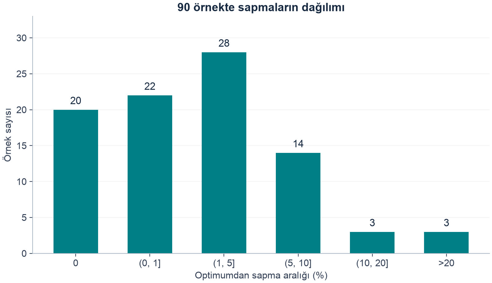
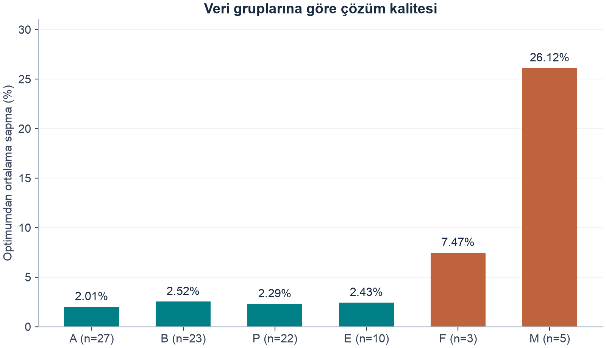
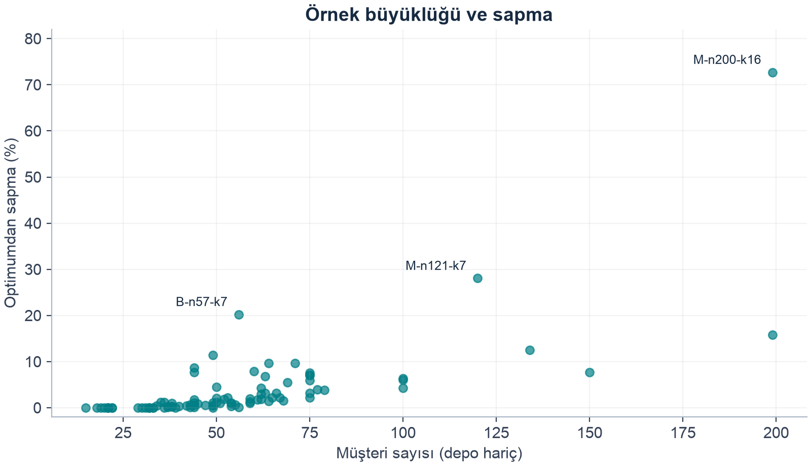
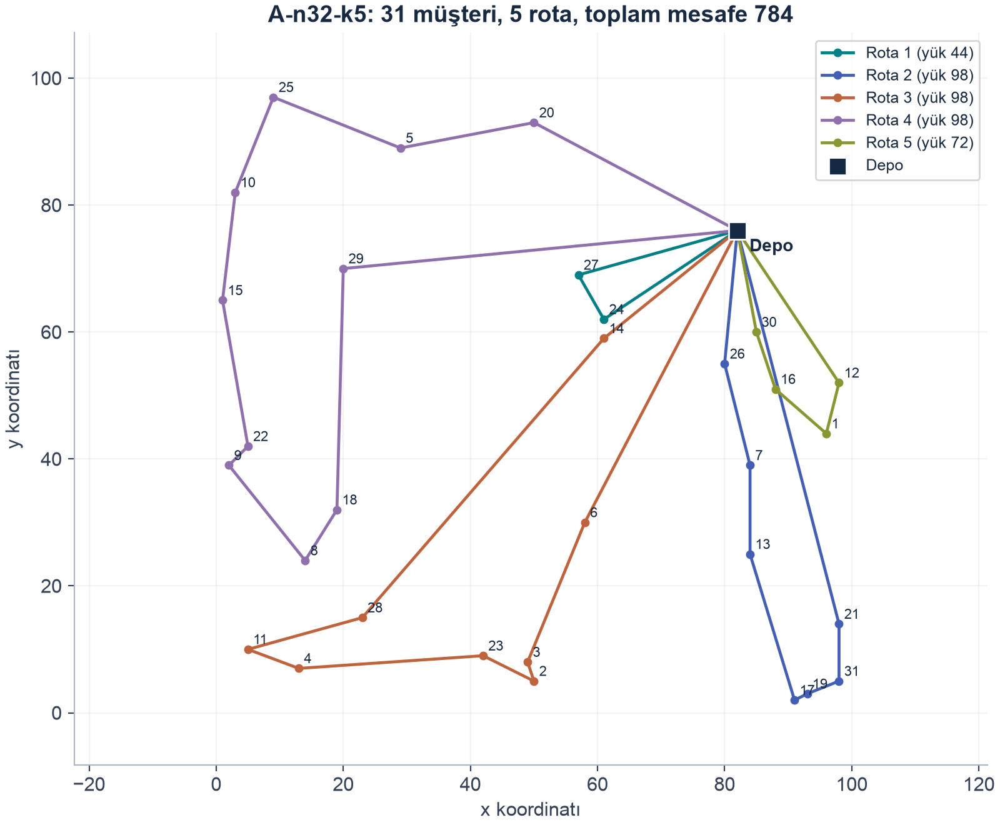

# CDELS - İlk aşama doğrulama raporu

**Python uygulaması ve sınırlı bütçeli sonuç doğrulaması**

BM368 Sezgisel Optimizasyon Algoritmaları | 29 Ekim 2026

İncelenen makale: Israel Pereira Souza, Maria Claudia Silva Boeres ve Renato Elias Nunes Moraes, A robust algorithm based on Differential Evolution with local search for the Capacitated Vehicle Routing Problem, Swarm and Evolutionary Computation 77 (2023), 101245. DOI: 10.1016/j.swevo.2023.101245.

## Özet

Bu çalışmada CDELS yönteminin ayrık çözüm gösterimi ve operatörleri Python ile uygulanmış, CVRPLIB’den alınan ve makalede raporlanan 90 örnek üzerinde sonuç karşılaştırması yapılmıştır. Her örnek tohum 42 ile bir kez çalıştırılmış; koşular en fazla 20 nesil veya yaklaşık 120 saniyeyle sınırlandırılmıştır. Bütün koşular geçerli çözüm üretmiş, 20 örnekte referans optimuma ulaşılmıştır. Örnekler üzerindeki ortalama yüzde sapma %3,78, medyan %1,15’tir. Son rotaların uygunluğu ve mesafesi arama hesabından bağımsız olarak denetlenmiştir. Deney bütçesi ve tekrar sayısı makaleden farklıdır. Çalışma, uygulamanın doğruluğunu ve bu bütçedeki çözüm kalitesini belgeleyen sınırlı bir doğrulamadır; makalenin tam performansının tekrarı veya istatistiksel eşdeğerlik iddiası içermez.

| Kapsam | Gerçekleşen |
| --- | --- |
| Örnek / geçerli çözüm | 90 / 90 |
| Optimum / en fazla %5 sapma | 20 / 70 örnek |
| Toplam çözücü süresi | 1591,35 saniye (26 dakika 31 saniye) |
| Teslim kapsamı | İlk makalenin CVRP uygulaması ve doğrulaması |

## 1. Amaç ve kapsam

Amaç, seçilen ilk makalede açıklanan CDELS yöntemini Python’da gerçekleştirmek ve bulunan çözümleri makaledeki CDELS sonuçları ile karşılaştırmaktır [1]. Çalışma tek depolu, homojen kapasiteli araç rotalama problemiyle sınırlıdır. İkinci makaledeki probleme uyarlama ve bu uyarlamanın deneyleri sonraki aşamaya bırakılmıştır.

Karşılaştırma makalede bulunan 90 örneğin tamamını kapsar. Parametre taraması yeniden yapılmamış, makalenin Tablo 6’da seçtiği strateji ve F/CR değerleri kullanılmıştır. Makale her örnekte on tekrar ve çok daha yüksek nesil sınırları kullanırken bu çalışma tek tohumlu kısa koşulara dayanır. Bu farklar sonuç yorumunun bir parçasıdır.

## 2. Problem tanımı

Bir depo, N müşteri, her müşterinin talebi q_i, ortak araç kapasitesi Q ve en fazla K araç verilir. Çözüm R = [R_1, ..., R_K] biçiminde rota listeleridir. Depo program içinde 0 kimliğine sahiptir ve rota listelerinde müşteri olarak tutulmaz. Her rota depodan başlar, kendisine atanan müşterileri ziyaret eder ve depoya döner.

Amaç bütün rotaların toplam mesafesini en aza indirmektir. Her müşteri tam bir kez ziyaret edilmelidir. Bir rotadaki taleplerin toplamı Q’yu aşamaz ve kullanılan boş olmayan rota sayısı K’yı geçemez. Talepler bölünmez. Boş rota listeleri araç sınırının altında bir planı temsil edebilir.

Bir rotanın maliyeti, depodan ilk müşteriye, ardışık müşteriler arasına ve son müşteriden depoya giden kenarların toplamıdır. İki düğümün mesafesi, koordinatları arasındaki Öklid uzaklığının floor(d + 0.5) ile tam sayıya yuvarlanmasıdır. Python’ın varsayılan round davranışı yerine TSPLIB95’e uygun bu kural kullanılmıştır [2,4].

## 3. Yöntem ve Python uygulaması

### 3.1. Birey ve başlangıç popülasyonu

Her birey bütün araçların planını içerir; bir birey tek bir araç değildir. Örneğin [[1, 4], [2, 5, 3]], iki araçlı tek çözümdür. N depo hariç müşteri sayısıdır ve NP = 3N bağımsız aday oluşturulur. A-n32-k5 örneğinde N=31, K=5 ve NP=93’tür. Başlangıçta müşteriler rastgele sırayla kapasiteye sığan rotalara yerleştirilir. Yerleşmeyen müşteriler rastgele bir rotaya eklenir; böylece bütün müşteri kimlikleri korunurken kapasite ihlalli başlangıç adayları oluşabilir.

### 3.2. Mutasyon ve PerturbationMove

Hedef birey dışında birbirinden farklı iki birey seçilir. İlk bireyin bağımsız kopyası temel adaydır, ikinci birey müşteri konumlarının referansıdır. F değerine göre ceil(N × F / 2) farklı müşteri seçilerek hareket girişimi yapılır. Referanstaki rota ve sıra bilgisi uygulanırken hedef konum doluysa iki müşteri takas edilir. Konum yoksa müşteri ilgili rotanın sonuna taşınır. Bu taşımada tek müşterili kaynak rota boşaltılmaz. Her girişim mutlaka farklı bir plan üretmez.

### 3.3. Exp çaprazlama

Trial, hedef bireyin kopyasıyla başlar. Mutantta rastgele dolu rota ve o rotada rastgele konum seçilerek CR kontrolü olmadan bir hareket girişimi yapılır. Ardından mutantın konumları ilk rotadan başlayarak sırayla taranır; ilk rastgele sayı CR’yi aştığında tarama biter. İşlenen müşteri kimlikleri yeniden seçilmeye karşı kapatılır; başka bir takasta yer değiştirebilmeleri mümkündür. CR=0,7, bütün müşterilerin kesin olarak %70’inin aktarılacağı anlamına gelmez.

### 3.4. Yerel arama, onarım ve seçim

Bir yerel arama turu üç işlemi sırasıyla yürütür: bütün uygun müşteri çiftleri arasından en fazla mesafe azaltan takas, her müşterinin başka rotadaki en iyi uygun konuma taşınması ve kapasite ihlali varsa onarım. Taşıma tek müşterili kaynak rotayı boşaltmaz. Onarım, ihlalli rotaları rastgele sırayla ele alır ve ilk taşınabilen müşteriyi uygun hedefte en düşük toplam mesafeyi veren konuma yerleştirir. Mesafe artabilir. Uygun taşıma kalmazsa onarım başarısız bitebilir.

Cezalı maliyet, toplam mesafe + (kapasite ihlali varsa 100, aksi halde 0) biçimindedir. Ceza yük aşımı miktarıyla çarpılmaz. Tam turun son maliyeti tur başından kesin olarak düşükse yeni tur başlar. Değilse tur başındaki bağımsız plan döner. Bu, makale Algoritma 4’teki Y* dönüşünün seçilen yorumudur. Tur içindeki en iyi geçerli plan ayrıca arşivlenir; seçimde geri alınan bir onarımda görülmüş uygun plan da korunabilir.

Yerel aramadan gelen trial, hedefin cezalı maliyetinden kesin olarak daha iyiyse yeni popülasyona girer. Eşitlikte hedef korunur. Nihai çıktı, popülasyondaki geçersiz bir aday değil, arama boyunca görülen en iyi geçerli plandır. Müşteri kapsamı hataları kapasite cezasıyla kabul edilmez; hata sayılır.

### 3.5. Uygulama tercihleri ve referans kodla farklar

| Konu | Bu çalışmada kullanılan davranış |
| --- | --- |
| Başlangıç | Kapasite için ≤ Q, kalanları rastgele rotaya ekleme. C kodundaki bazı sınır/rota tercihleri yerine makalenin ilgili anlatımı esas alındı. |
| Sayım | N depo hariç ve hareket sayısı ceil(N×F/2). Sayım ve tamsayı dönüşümünde C koduyla birebirlik iddia edilmiyor. |
| Exp çaprazlama | Tablo 6’daki rand/1/exp ile C kodunun exp dalındaki ilk başarısız CR kontrolünde bitiş birlikte esas alındı. Algoritma 3’ün genel taraması tek başına uygulanmadı. |
| Yerel arama | C kodunun iyileşmeyen operatör sayacı yerine Algoritma 4’ün tam tur karşılaştırması ve önceki çözüme dönüşü seçildi. |
| Rastgelelik | Haricî random.Random nesnesi kullanıldı. C ve Python rastgele sayı akışlarının aynı olduğu iddia edilmiyor. |
| Hızlandırma | Değişen kenarların tamsayı mesafe farkları ve rota yükleri kullanıldı. Tarama sırası, ilk eşit aday tercihi ve RNG durumu eşdeğerlik testleriyle karşılaştırıldı. |

Bu tercihler makale ile kaynak kod arasında yorum gerektiren noktaları görünür kılar. Uygulama, yazarların C programının birebir portu veya bit düzeyinde tekrarı olarak sunulmamaktadır. C kaynak kodu inceleme amacıyla referans alınmıştır [3]. Teslim paketinde yazarların C dosyaları dağıtılmamaktadır; kaynak ve lisans bağlantıları korunmuştur.

## 4. Deney düzeni

| Özellik | Makale [1] | Bu çalışma |
| --- | --- | --- |
| Örnekler | A/B/P/E/F/M: 90 örnek | Aynı 90 örnek |
| Tekrar sayısı | Her örnekte 10 | Her örnekte 1 |
| Tohum | İlk on tam sayı olarak belirtiliyor | 42 |
| Popülasyon, strateji | NP=3N, rand/1/exp | NP=3N, rand/1/exp |
| F, CR, ceza | 0,7; 0,7; 100 | 0,7; 0,7; 100 |
| Nesil sınırı | A/B/E/F/P: 200.000; M: 500.000 | Bütün gruplar: 20 |
| Süre sınırı | Bu çalışmadaki 120 sn sınırı yok | 120 sn, yumuşak |
| Erken durma | Bilinen optimuma ulaşma | Bilinen optimuma ulaşma |
| Uygulama ve ortam | C, gcc 5.4.0 -O3, Intel i5-3570, Ubuntu 16.04 | Python 3.12.14, macOS, arm64; sistem/paket kaydı metadata.json içinde |

90 örneğin grup sayıları A=27, B=23, P=22, E=10, F=3, M=5’tir. Her veri ve referans çözüm dosyasının SHA-256 kimliği kayıtlıdır. CVRPLIB’deki referans çözümlerin uygunluğu ve yeniden hesaplanan mesafesi kontrol edilmiştir. Bu 90 örnekte makalenin BKS değerleri ile kullanılan doğrulanmış optimumlar eşleşmektedir. Başka CVRPLIB örnekleri deneye eklenmemiştir.

Süre sınırı aktif hedefi yarıda kesmez. Başlangıçtan ve her tamamlanan hedefin ardından geçen aktif süre kontrol edilir. Bu nedenle 120 saniye biraz aşılabilir. Nesil sayısı yalnız bütün NP hedef tamamlandığında artar; kısmi nesildeki hedef sayısı ayrıca kaydedilir. Ara kayıt devamı aynı popülasyon ve RNG durumunu korur, duraklama süresini hesaplama bütçesine katmaz.

Tek ayar dosyası configs/dogrulama.json, deney kimliği paper90_screening_v3-818bc1da2558489d’dir. Ham kayıtlar results/experiments/ altında bulunur. Her result.json; son rotaları, mesafeyi, süreyi, durma nedenini, tam ve kısmi nesil bilgisini ve bağımsız denetimi içerir. metadata.json kaynak/veri/ortam kimliklerini taşır. Sayısal tablolar bu kayıtların yeniden okunmasıyla hazırlanmıştır.

## 5. Doğruluk ve tekrar üretilebilirlik

Son çözümler dört açıdan denetlendi: beklenen müşterilerin tam bir kez bulunması, rota yüklerinin kapasiteyi aşmaması, kullanılan araç sayısının sınırda kalması ve mesafenin özgün koordinatlardan yeniden hesaplanması. Bu son hesap, aramanın kullandığı mesafe matrisine güvenmez. 90 son planın tamamı denetimden geçti; doğrulanmış optimumun altında şüpheli maliyet bulunmadı.

60 otomatik kontrol; küçük örneğin bağımsız kesin çözümünü, operatörlerin ebeveynleri değiştirmemesini, kapasite onarımının başarı ve başarısızlık durumlarını, yerel arama geri dönüşünü, veri okumayı, süre sınırını ve kesintiden devamı kapsar. Hızlandırılmış yerel arama 300 rastgele küçük durumda eski hesapla aynı rota ve RNG durumunu verdi. Kenar farkları bütün uygun konumlardaki tam maliyetle ayrıca karşılaştırıldı.

A-n32-k5, Python 3.12.14 ve tohum 42 ile iki kez yeniden çalıştırıldı. Her iki tekrarın rotaları, maliyeti 784, uygunluğu, tamamlanan nesil ve kısmi hedef sayısı ile durma nedeni özgün kayda eşleşti. Bu bir örnek üzerindeki tekrar üretilebilirlik kontrolüdür; süreye bağlı bütün koşuların aynı hedefte biteceği garantisi değildir.

## 6. Bulgular

| Gösterge | Değer |
| --- | --- |
| Geçerli koşu / toplam | 90 / 90 |
| Optimuma ulaşan | 20 / 90 (%22,22) |
| Optimumdan en fazla %1 sapma | 42 / 90 |
| Optimumdan en fazla %5 sapma | 70 / 90 |
| Ortalama / medyan yüzde sapma | %3,78 / %1,15 |
| En yüksek yüzde sapma | %72,68 (M-n200-k16) |
| Durma nedenleri | 20 optimum, 65 nesil sınırı, 5 süre sınırı |
| Toplam çözücü süresi | 1591,35 saniye |
| Hata / kesinti / geçerli çözüm bulunamayan | 0 / 0 / 0 |

Yüzde sapma, 100 × (bulunan mesafe - referans optimum) / referans optimum formülüyle hesaplandı. %3,78 değeri 90 örneğin sapmalarının ağırlıksız ortalamasıdır. Örneklerin tek tek koşu ortalaması veya makalenin on tekrar üzerinden hesapladığı Avg değildir. Her örnekte bir ölçüm bulunduğu için koşular arası ortalama ve standart sapma hesaplanmadı.

Şekil 1. Tek koşu sonuçlarının optimumdan yüzde sapma dağılımı. Aralıklar birbirini dışlar; 90 örneğin tamamı gösterilir.

20 örnekte sapma sıfırdır. Buna ek 22 örnek %1’e, 28 örnek %5’e kadar farkla sonuçlanmıştır. Toplam 70 örneğin %5 içinde olması, küçük ortalama sapmanın bütün örneklerde yüksek kalite anlamına gelmediğiyle birlikte okunmalıdır; üç örnekte sapma %20’yi aşar.

### 6.1. Veri gruplarına göre bulgular

Şekil 2. Her veri grubunda örneklerin yüzde sapmalarının ortalaması. Grup büyüklükleri eşit değildir.

| Grup | Örnek | Bizim optimum | Makale Best optimum | Ort. sapma % |
| --- | --- | --- | --- | --- |
| A | 27 | 5 | 27 | 2,01 |
| B | 23 | 3 | 23 | 2,52 |
| P | 22 | 8 | 22 | 2,29 |
| E | 10 | 4 | 10 | 2,43 |
| F | 3 | 0 | 3 | 7,47 |
| M | 5 | 0 | 3 | 26,12 |

A, B, P ve E gruplarındaki ortalama sapmalar %2,01 ile %2,52 arasındadır. F grubunda %7,47, M grubunda %26,12 bulunmuştur. F yalnız 3, M ise 5 örnek içerir. M-n200-k16’nın yüksek sapması hem grup hem genel ortalamayı etkiler. Bu örnek çıkarıldığında kalan 89 örneğin ortalama sapması yaklaşık %3,00 olur; raporun ana sonucu, hiçbir örnek dışlanmadan hesaplanan %3,78’dir.

Makalenin Best sütununda 88/90 örnekte optimum bulunmuştur [1, Tablo 11]. Bu çalışmanın 20/90 sonucu aynı tekrar sayısı ve bütçeyi kullanmaz. Dolayısıyla bu sayılar, eşit koşullardaki iki algoritmanın başarı oranı veya anlamlılık karşılaştırması olarak yorumlanamaz.

### 6.2. Sapmaların incelenmesi

Şekil 3. Müşteri sayısı ve tek koşudaki yüzde sapma. Büyüklük ile sapma ilişkisi betimseldir; nedensellik veya anlamlılık testi yapılmamıştır.

| Örnek | BKS | Makale Best | Bu koşu | Sapma % |
| --- | --- | --- | --- | --- |
| A-n32-k5 | 784 | 784 | 784 | 0,00 |
| P-n16-k8 | 450 | 450 | 450 | 0,00 |
| B-n57-k7 | 1153 | 1153 | 1386 | 20,21 |
| F-n135-k7 | 1162 | 1162 | 1308 | 12,56 |
| M-n121-k7 | 1034 | 1034 | 1324 | 28,05 |
| M-n200-k16 | 1274 | 1315 | 2200 | 72,68 |
| M-n200-k17 | 1275 | 1284 | 1477 | 15,84 |

M-n200-k16, 120,33 saniyede ilk neslin 263/597 hedefini tamamlamış ve 2200 mesafe üretmiştir. Referans optimum 1274, makalenin Best değeri 1315’tir. M-n121-k7’de 1324/1034, M-n200-k17’de 1477/1275 elde edilmiştir. Bu örnekler bütçe yetersizliğinin araştırılması gereken başlıca durumlardır. Buna karşılık B-n57-k7 süre sınırına değil 20 nesil sınırına takılmış ve %20,21 farkla kalmıştır. Bütün sapmaları tek başına 120 saniyelik sınırla açıklamak doğru değildir.

Makale de iki büyük M örneğinde optimuma ulaşmamıştır. Ancak makalenin 1315 ve 1284 Best değerleri, bu çalışmanın 2200 ve 1477 sonuçlarından belirgin biçimde daha iyidir. Yöntem aktarımının işlevsel doğruluğu, yayımlanan performans düzeyinin doğrulanmasıyla aynı sonuç değildir.

### 6.3. Örnek rota çözümü

Şekil 4. A-n32-k5 için bulunan gerçek rota planı. Sayılar program içindeki müşteri kimlikleridir; 0 depo kimliğidir. Çizim coğrafi harita değil girdi koordinatlarının gösterimidir.

| Rota | Müşteri sayısı | Yük / kapasite | Mesafe |
| --- | --- | --- | --- |
| 1 | 2 | 44 / 100 | 59 |
| 2 | 7 | 98 / 100 | 155 |
| 3 | 8 | 98 / 100 | 230 |
| 4 | 10 | 98 / 100 | 267 |
| 5 | 4 | 72 / 100 | 73 |
| Toplam | 31 | 5 araç | 784 |

Her müşteri bir kez ziyaret edilmiş, beş rota da kapasite 100 sınırını sağlamıştır. Rota mesafelerinin toplamı 784’tür ve referans optimuma eşittir. Bir optimum maliyet birden fazla rota düzeniyle elde edilebileceğinden referans .sol dosyasıyla rota sırasının aynı olması gerekmemektedir. Görsel sonuç, bağımsız müşteri/yük/mesafe denetimiyle birlikte değerlendirilmiştir.

## 7. Tartışma ve sınırlılıklar

Birinci sınırlılık, deney bütçesidir. Makalenin yüz binlerce nesil sınırına karşılık burada en fazla 20 nesil veya 120 saniye kullanılmıştır. Bu kapsam, kısa bütçede çözüm üretimini ve maliyet hesabını doğrular. Bütçe farkının ne kadarını açıkladığını ölçen kontrollü uzun koşular yapılmadığından performans açığının yalnız bu etkiden kaynaklandığı söylenemez.

İkinci sınırlılık, tek tohumdur. Rastgeleliğe karşı dayanıklılık, koşular arası standart sapma ve makalenin on tekrarlı Avg davranışı test edilmemiştir. Tek maliyetin makale Best/Avg sütunlarının yanına konması betimsel karşılaştırmadır. Wilcoxon/Friedman gibi testler yapılmamış, makaledeki %99 güven iddiası bu çalışmanın sonucu olarak aktarılmamıştır.

Üçüncü sınırlılık, uygulama yorumlarıdır. Başlangıç, sayım, exp çaprazlama ve yerel arama dönüşü için alınan kararlar Bölüm 3.5’te açıklanmıştır. Hızlandırma için karar eşdeğerliği kontrolleri yapılması, seçilen yorumun C kodu veya yayımlanan deneylerle aynı olduğunu kanıtlamaz. Bu tercihlerin tek tek etkisini ayıran deneyler yapılmamıştır.

Süreler C ve Python, donanım, derleyici ve durma koşulları farklı olduğu için doğrudan algoritmik üstünlük göstergesi değildir. Kayıtlardaki 1591,35 saniye, toplam aktif çözücü süresidir. Önceki Python sürümüyle aynı ortamda kısa tarama 5062,21 saniye sürmüştür. Yeni sürüm 17 örneği iyileştirmiş, 73’ünde aynı maliyeti vermiştir. Bu, uygulama hızlandırmasının faydasını gösterir; makaleden daha hızlı veya daha iyi algoritma kanıtı değildir.

Nesil başına en iyi maliyeti içeren tam bir yakınsama dizisi kaydedilmediği için yakınsama eğrisi üretilmemiştir. Son maliyetler, histogram, veri grubu ortalamaları ve gerçek rota planı gösterilmiştir. Her örneğin maliyeti ve süresi Ek A’da, rota ve doğrulama ayrıntıları ham JSON kayıtlarında bulunur.

## 8. Sonuç

CDELS’in Python uygulaması gerçekleştirilmiş; makaledeki 90 örneğin tamamı üzerinde açıkça belirtilen tek tohumlu, kısa bütçeli doğrulama kapsamı tamamlanmıştır. Bütün koşular bağımsız denetimden geçen uygun çözümler üretmiştir. 20 örnek optimuma ulaşmış, 70 örnekte sapma %5’i aşmamıştır. Ortalama sapma %3,78, medyan %1,15’tir. Büyük ve bazı orta boy örneklerde belirgin kalite farkları sürmektedir.

Bu sonuçlar uygulamanın işlevselliğini, veri/mesafe doğruluğunu ve belirlenen bütçedeki kaliteyi destekler. Makalenin 88/90 Best başarısı, on tekrarlı istikrarı veya istatistiksel üstünlük sonuçları yeniden üretilmiş sayılmaz. İlk aşamanın teslimi kod, ayar, ham sonuçlar, bu rapor ve sunumdan oluşur. İkinci makalenin problemine uyarlama sonraki aşamada ele alınacaktır.

## Kaynakça

[1] Souza, I. P., Boeres, M. C. S. ve Moraes, R. E. N. (2023). A robust algorithm based on Differential Evolution with local search for the Capacitated Vehicle Routing Problem. Swarm and Evolutionary Computation, 77, 101245. https://doi.org/10.1016/j.swevo.2023.101245. Özellikle Bölüm 4-5, Algoritmalar 1-7, Tablolar 6-12.

[2] CVRPLIB. CVRP örnekleri ve referans çözümleri. https://galgos.inf.puc-rio.br/cvrplib/en/instances/1. Veri dosyalarının alınma tarihi ve kaynak bağlantıları data/paper90_instances.json içinde kayıtlıdır.

[3] Souza, I. P. CDELS kaynak kod deposu. https://github.com/israelpereira55/CDELS. Yöntem incelemesinde referans alınmıştır. Depo MIT lisansını belirtir; özgün lisans: https://github.com/israelpereira55/CDELS/blob/master/LICENSE.

[4] Reinelt, G. (1995). TSPLIB95. Interdisziplinäres Zentrum für Wissenschaftliches Rechnen, Universität Heidelberg. https://www.iwr.uni-heidelberg.de/groups/comopt/software/TSPLIB95/.

[5] Bu çalışmanın deney kayıtları (28 Ekim 2026). results/experiments/paper90_screening_v3-818bc1da2558489d/. Sabit tohumlu yeniden çalışma kontrolü ve analiz özeti: results/analysis/.

## Ek A. 90 örneğin makaleyle karşılaştırması

Makale Best ve Avg değerleri [1, Tablolar 7-10] üzerinden hazırlanan veri kaydından alınmıştır. Bu koşu sütunu tek ölçümdür. Sapma referans optimuma göredir, yüzde birimiyle verilmiştir. Süreler bu çalışmanın aktif çözücü süresidir. Kayıp/geçersiz koşu yoktur; tüm 90 satır raporlanır.

| Örnek | BKS | Mak. Best | Mak. Avg | Bu koşu | Sapma % | Süre sn |
| --- | --- | --- | --- | --- | --- | --- |
| A-n32-k5 | 784 | 784 | 784,0 | 784 | 0,00 | 1,07 |
| A-n33-k5 | 661 | 661 | 661,0 | 661 | 0,00 | 0,33 |
| A-n33-k6 | 742 | 742 | 742,0 | 742 | 0,00 | 0,96 |
| A-n34-k5 | 778 | 778 | 778,0 | 778 | 0,00 | 1,12 |
| A-n36-k5 | 799 | 799 | 799,0 | 809 | 1,25 | 2,60 |
| A-n37-k5 | 669 | 669 | 669,0 | 669 | 0,00 | 1,09 |
| A-n37-k6 | 949 | 949 | 949,0 | 960 | 1,16 | 2,96 |
| A-n38-k5 | 730 | 730 | 730,0 | 732 | 0,27 | 3,31 |
| A-n39-k5 | 822 | 822 | 822,0 | 830 | 0,97 | 3,18 |
| A-n39-k6 | 831 | 831 | 831,0 | 833 | 0,24 | 3,39 |
| A-n44-k6 | 937 | 937 | 937,0 | 943 | 0,64 | 5,53 |
| A-n45-k6 | 944 | 944 | 944,0 | 1017 | 7,73 | 4,78 |
| A-n45-k7 | 1146 | 1146 | 1146,0 | 1158 | 1,05 | 5,43 |
| A-n46-k7 | 914 | 914 | 914,0 | 922 | 0,88 | 5,20 |
| A-n48-k7 | 1073 | 1073 | 1073,0 | 1079 | 0,56 | 6,41 |
| A-n53-k7 | 1010 | 1010 | 1010,0 | 1029 | 1,88 | 8,05 |
| A-n54-k7 | 1167 | 1167 | 1167,0 | 1192 | 2,14 | 9,29 |
| A-n55-k9 | 1073 | 1073 | 1073,0 | 1077 | 0,37 | 10,04 |
| A-n60-k9 | 1354 | 1354 | 1354,0 | 1367 | 0,96 | 12,85 |
| A-n61-k9 | 1034 | 1034 | 1034,0 | 1116 | 7,93 | 13,72 |
| A-n62-k8 | 1288 | 1288 | 1288,0 | 1311 | 1,79 | 12,69 |
| A-n63-k10 | 1314 | 1314 | 1314,0 | 1338 | 1,83 | 15,01 |
| A-n63-k9 | 1616 | 1616 | 1616,0 | 1685 | 4,27 | 16,36 |
| A-n64-k9 | 1401 | 1401 | 1401,0 | 1445 | 3,14 | 14,66 |
| A-n65-k9 | 1174 | 1174 | 1174,0 | 1288 | 9,71 | 17,27 |
| A-n69-k9 | 1159 | 1159 | 1159,0 | 1177 | 1,55 | 18,29 |
| A-n80-k10 | 1763 | 1763 | 1763,0 | 1831 | 3,86 | 29,69 |
| B-n31-k5 | 672 | 672 | 672,0 | 672 | 0,00 | 0,59 |
| B-n34-k5 | 788 | 788 | 788,0 | 788 | 0,00 | 0,73 |
| B-n35-k5 | 955 | 955 | 955,0 | 959 | 0,42 | 2,49 |
| B-n38-k6 | 805 | 805 | 805,0 | 806 | 0,12 | 3,49 |
| B-n39-k5 | 549 | 549 | 549,0 | 551 | 0,36 | 3,50 |
| B-n41-k6 | 829 | 829 | 829,0 | 832 | 0,36 | 4,74 |
| B-n43-k6 | 742 | 742 | 742,0 | 745 | 0,40 | 4,75 |
| B-n44-k7 | 909 | 909 | 909,0 | 910 | 0,11 | 4,54 |
| B-n45-k5 | 751 | 751 | 751,0 | 764 | 1,73 | 5,36 |
| B-n45-k6 | 678 | 678 | 678,0 | 737 | 8,70 | 5,17 |
| B-n50-k7 | 741 | 741 | 741,0 | 741 | 0,00 | 1,83 |
| B-n50-k8 | 1312 | 1312 | 1312,0 | 1318 | 0,46 | 6,99 |
| B-n51-k7 | 1032 | 1032 | 1032,0 | 1054 | 2,13 | 8,68 |
| B-n52-k7 | 747 | 747 | 747,0 | 754 | 0,94 | 7,83 |
| B-n56-k7 | 707 | 707 | 707,0 | 712 | 0,71 | 10,23 |
| B-n57-k7 | 1153 | 1153 | 1153,0 | 1386 | 20,21 | 8,93 |
| B-n57-k9 | 1598 | 1598 | 1598,0 | 1599 | 0,06 | 11,20 |
| B-n63-k10 | 1496 | 1496 | 1496,0 | 1540 | 2,94 | 15,65 |
| B-n64-k9 | 861 | 861 | 861,0 | 920 | 6,85 | 15,60 |
| B-n66-k9 | 1316 | 1316 | 1316,0 | 1345 | 2,20 | 19,44 |
| B-n67-k10 | 1032 | 1032 | 1032,0 | 1065 | 3,20 | 18,71 |
| B-n68-k9 | 1272 | 1272 | 1272,1 | 1300 | 2,20 | 18,84 |
| B-n78-k10 | 1221 | 1221 | 1221,0 | 1269 | 3,93 | 29,71 |
| P-n16-k8 | 450 | 450 | 450,0 | 450 | 0,00 | 0,00 |
| P-n19-k2 | 212 | 212 | 212,0 | 212 | 0,00 | 0,03 |
| P-n20-k2 | 216 | 216 | 216,0 | 216 | 0,00 | 0,10 |
| P-n21-k2 | 211 | 211 | 211,0 | 211 | 0,00 | 0,06 |
| P-n22-k2 | 216 | 216 | 216,0 | 216 | 0,00 | 0,42 |
| P-n22-k8 | 603 | 603 | 603,0 | 603 | 0,00 | 0,01 |
| P-n23-k8 | 529 | 529 | 529,0 | 529 | 0,00 | 0,05 |
| P-n40-k5 | 458 | 458 | 458,0 | 458 | 0,00 | 0,37 |
| P-n45-k5 | 510 | 510 | 510,0 | 513 | 0,59 | 5,38 |
| P-n50-k10 | 696 | 696 | 696,0 | 704 | 1,15 | 8,11 |
| P-n50-k7 | 554 | 554 | 554,0 | 557 | 0,54 | 7,40 |
| P-n50-k8 | 631 | 631 | 631,0 | 703 | 11,41 | 6,55 |
| P-n51-k10 | 741 | 741 | 741,0 | 774 | 4,45 | 7,06 |
| P-n55-k10 | 694 | 694 | 694,1 | 700 | 0,86 | 9,83 |
| P-n55-k7 | 568 | 568 | 568,0 | 574 | 1,06 | 10,23 |
| P-n60-k10 | 744 | 744 | 744,0 | 759 | 2,02 | 15,04 |
| P-n60-k15 | 968 | 968 | 968,0 | 981 | 1,34 | 13,91 |
| P-n65-k10 | 792 | 792 | 792,0 | 803 | 1,39 | 18,36 |
| P-n70-k10 | 827 | 827 | 827,0 | 872 | 5,44 | 25,24 |
| P-n76-k4 | 593 | 593 | 593,0 | 635 | 7,08 | 38,10 |
| P-n76-k5 | 627 | 627 | 627,0 | 671 | 7,02 | 36,49 |
| P-n101-k4 | 681 | 681 | 681,0 | 722 | 6,02 | 72,35 |
| E-n22-k4 | 375 | 375 | 375,0 | 375 | 0,00 | 0,12 |
| E-n23-k3 | 569 | 569 | 569,0 | 569 | 0,00 | 0,02 |
| E-n30-k3 | 534 | 534 | 534,0 | 534 | 0,00 | 0,59 |
| E-n33-k4 | 835 | 835 | 835,0 | 835 | 0,00 | 0,75 |
| E-n51-k5 | 521 | 521 | 521,0 | 527 | 1,15 | 8,67 |
| E-n76-k10 | 830 | 830 | 830,0 | 893 | 7,59 | 31,84 |
| E-n76-k14 | 1021 | 1021 | 1021,0 | 1081 | 5,88 | 29,15 |
| E-n76-k7 | 682 | 682 | 682,0 | 697 | 2,20 | 27,05 |
| E-n76-k8 | 735 | 735 | 735,0 | 758 | 3,13 | 28,62 |
| E-n101-k14 | 1067 | 1067 | 1067,0 | 1113 | 4,31 | 55,99 |
| F-n45-k4 | 724 | 724 | 724,0 | 725 | 0,14 | 5,23 |
| F-n72-k4 | 237 | 237 | 237,0 | 260 | 9,70 | 22,15 |
| F-n135-k7 | 1162 | 1162 | 1162,1 | 1308 | 12,56 | 120,00 |
| M-n101-k10 | 820 | 820 | 820,0 | 872 | 6,34 | 71,38 |
| M-n121-k7 | 1034 | 1034 | 1034,0 | 1324 | 28,05 | 120,00 |
| M-n151-k12 | 1015 | 1015 | 1016,7 | 1093 | 7,68 | 120,03 |
| M-n200-k16 | 1274 | 1315 | 1329,3 | 2200 | 72,68 | 120,33 |
| M-n200-k17 | 1275 | 1284 | 1288,6 | 1477 | 15,84 | 120,06 |
